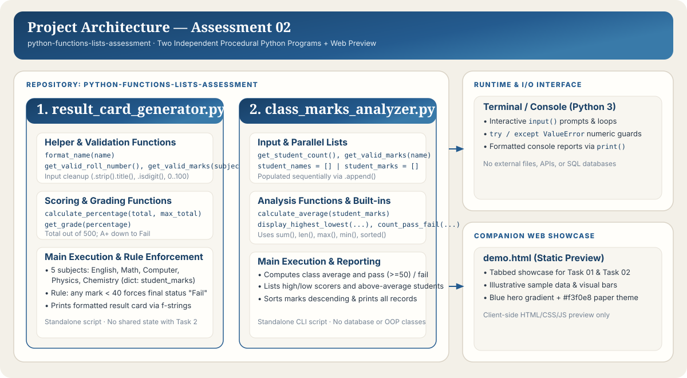
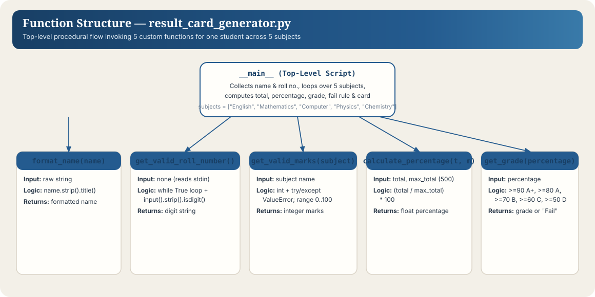
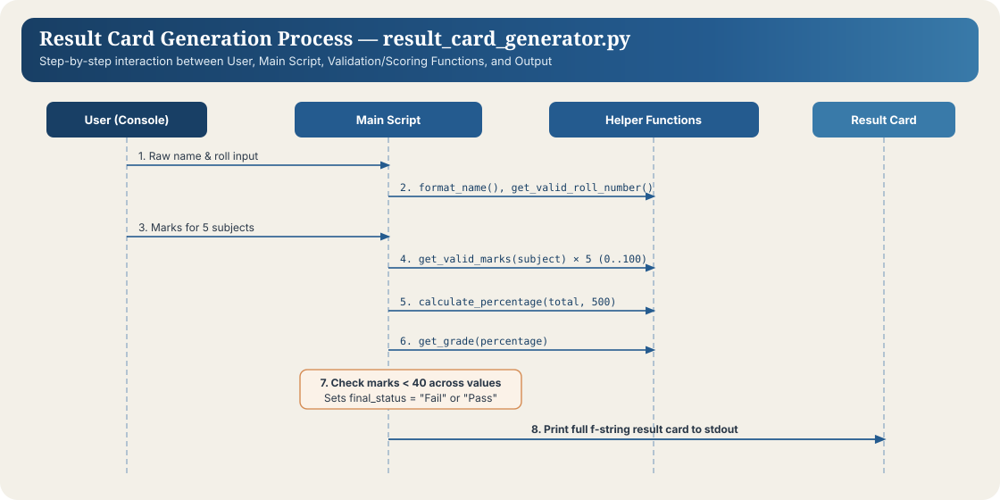
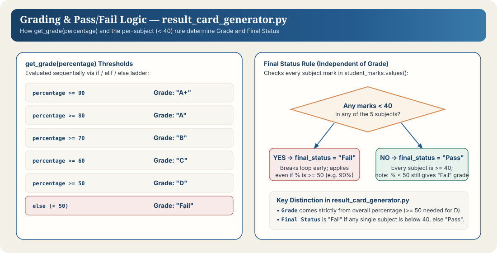
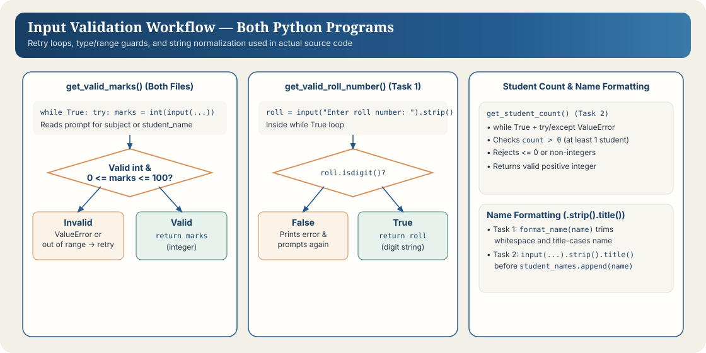
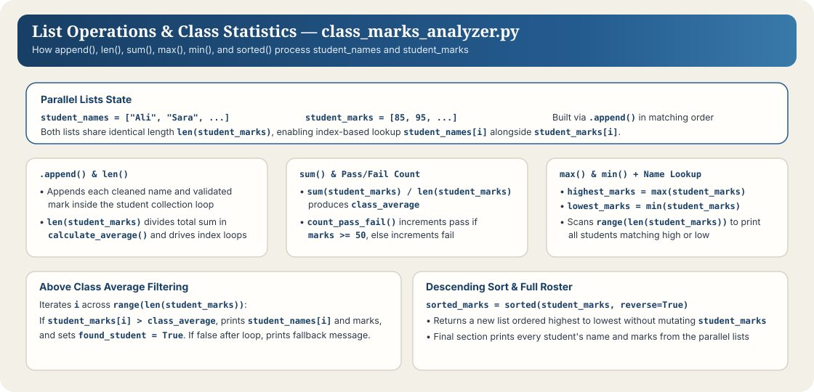
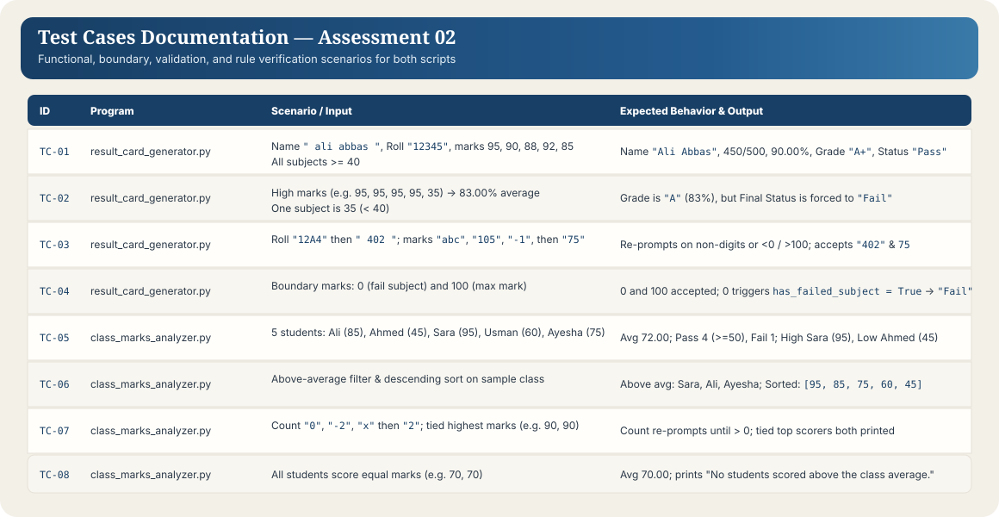

 <div align="center">

<a href="https://aliabbas0014.github.io/python-functions-lists-assessment/demo.html">

</a>

# 🎓 Student Performance Management System

### Python Bootcamp — Assessment 02

**Functions · Strings · Lists**

A Python-based student result card generator and class marks analyzer.

<br>

<a href="https://aliabbas0014.github.io/python-functions-lists-assessment/demo.html">

</a>
<a href="https://github.com/aliabbas0014/python-functions-lists-assessment">

</a>
<a href="#project-overview">

</a>

<br><br>


<br><br>


</div>

---

<a id="project-overview"></a>

## 📌 Project Overview

This project is developed as part of **Python Bootcamp Assessment 02**, focusing on the practical use of functions, strings, lists, loops, and conditional statements.

It contains two separate Python applications designed to manage student marks, generate result cards, and analyze class performance.

A separate HTML demo page is also included to provide a visual preview of both applications.

## 🚀 Applications

### 1. Student Result Card Generator

**File:** `result_card_generator.py`

This program collects a student's personal information and marks in five subjects, then generates a formatted result card.

**Main Features:**
- Takes student name and roll number.
- Accepts marks in five subjects.
- Validates marks between 0 and 100.
- Checks that the roll number contains digits only.
- Calculates total marks and percentage.
- Assigns grades according to percentage.
- Checks individual subject marks for passing criteria.
- Displays a complete student result card.

**Functions Used:**

| Function | Purpose |
|---|---|
| `format_name()` | Cleans and formats the student's name. |
| `get_valid_marks()` | Accepts and validates subject marks. |
| `calculate_percentage()` | Calculates the percentage. |
| `get_grade()` | Determines the grade. |
| `get_valid_roll_number()` | Validates the roll number. |

**Grading Criteria:**

| Percentage | Grade |
|---|---|
| 90% and above | A+ |
| 80% – 89% | A |
| 70% – 79% | B |
| 60% – 69% | C |
| 50% – 59% | D |
| Below 50% | Fail |

**Passing Rule:** A student must score at least 40 marks in every subject. If marks in any subject are below 40, the final result will be Fail regardless of the overall percentage.

### 2. Class Marks Analyzer

**File:** `class_marks_analyzer.py`

This program collects marks of multiple students and analyzes the overall class performance.

**Main Features:**
- Takes the total number of students.
- Stores student names and marks in separate lists.
- Validates marks between 0 and 100.
- Calculates class average.
- Finds highest and lowest marks.
- Identifies students with highest and lowest marks.
- Counts passed and failed students.
- Displays students scoring above the class average.
- Sorts marks in descending order.

**Functions Used:**

| Function | Purpose |
|---|---|
| `get_student_count()` | Gets the number of students. |
| `get_valid_marks()` | Accepts and validates student marks. |
| `calculate_average()` | Calculates the class average. |
| `display_highest_lowest()` | Displays highest and lowest marks with student names. |
| `count_pass_fail()` | Counts passed and failed students. |

**Passing Criteria:**
- 50 marks or above: Pass
- Below 50 marks: Fail

---

## 🏗️ System Design & Documentation

The following diagrams illustrate the structure, logic, workflows, and testing approach of both Python applications.

### Project Architecture



### Function Structures

These diagrams show how the custom functions are organized and how different parts of each program work together.

<details>
<summary><b>Student Result Card Generator — Function Structure</b></summary>
<br>

</details>

<details>
<summary><b>Class Marks Analyzer — Function Structure</b></summary>
<br>

</details>

### Use Case Diagram


### Program Flowcharts

The flowcharts explain the main execution steps and decision-making processes in both applications.

<details>
<summary><b>Student Result Card Generator — Flowchart</b></summary>
<br>

</details>

<details>
<summary><b>Class Marks Analyzer — Flowchart</b></summary>
<br>

</details>

### Process Workflows

<details>
<summary><b>Result Generation Process</b></summary>
<br>

</details>

<details>
<summary><b>Class Data Processing</b></summary>
<br>

</details>

<details>
<summary><b>Grading Decision Flowchart</b></summary>
<br>

</details>

<details>
<summary><b>Input Validation Workflow</b></summary>
<br>

</details>

<details>
<summary><b>List Processing Workflow</b></summary>
<br>

</details>

### Testing Documentation

These diagrams provide an overview of test scenarios and the testing process used to check program functionality.

<details>
<summary><b>Test Cases</b></summary>
<br>

</details>

<details>
<summary><b>Testing Workflow</b></summary>
<br>

</details>

---

## 🛠️ Technologies & Concepts

| Concept | Usage |
|---|---|
| Python | Main programming language |
| Functions | Dividing programs into reusable blocks |
| Strings | Handling student names and roll numbers |
| Lists | Storing student names and marks |
| `append()` | Adding student data to lists |
| `if / elif / else` | Applying conditions and grading rules |
| `for` loops | Processing multiple students and subjects |
| `while` loops | Repeating input until valid data is entered |
| `try / except` | Handling invalid numeric input |
| `isdigit()` | Checking numeric roll number input |
| `strip()` | Removing unnecessary spaces |
| `title()` | Formatting student names |
| `sorted()` | Sorting marks in descending order |
| F-Strings | Displaying formatted output |

## 📂 Project Structure

```text
python-functions-lists-assessment/
│
├── assets/
│   ├── assessment-02/
│   │   ├── project-architecture.svg
│   │   ├── result-card-function-structure.svg
│   │   ├── class-analyzer-function-structure.svg
│   │   ├── use-case-diagram.svg
│   │   ├── result-card-flowchart.svg
│   │   ├── class-analyzer-flowchart.svg
│   │   ├── result-generation-process.svg
│   │   ├── class-data-processing.svg
│   │   ├── grading-decision-flowchart.svg
│   │   ├── input-validation-workflow.svg
│   │   ├── list-processing-workflow.svg
│   │   ├── test-cases.svg
│   │   └── testing-workflow.svg
│   │
│   └── svg-buttons/
│       ├── live-demo.svg
│       ├── source-code.svg
│       └── explore-project.svg
│
├── result_card_generator.py
├── class_marks_analyzer.py
├── README.md
└── demo.html
```

## ⚙️ Requirements

- Python 3.x
- Visual Studio Code or any Python-supported editor
- Windows, Linux, or macOS

No external Python libraries are required.

## ▶️ How to Run

**Step 1:** Clone or download this repository.

```bash
git clone https://github.com/aliabbas0014/python-functions-lists-assessment.git
```

**Step 2:** Open the project folder in Visual Studio Code or a terminal.

**Step 3:** Run the Student Result Card Generator:

```bash
py result_card_generator.py
```

**Step 4:** Run the Class Marks Analyzer:

```bash
py class_marks_analyzer.py
```

**Alternative:** If the `py` command is not available, try:

```bash
python result_card_generator.py
```

```bash
python class_marks_analyzer.py
```

## 📊 Sample Outputs

### Student Result Card Generator

**Sample Input:**

```text
Enter student name: ali abbas
Enter roll number: 12345

Enter English marks: 95
Enter Mathematics marks: 90
Enter Computer marks: 88
Enter Physics marks: 92
Enter Chemistry marks: 85
```

**Sample Result:**

```text
====================================
        STUDENT RESULT CARD
====================================

Student Name: Ali Abbas
Roll Number: 12345

English:       95
Mathematics:   90
Computer:      88
Physics:       92
Chemistry:     85

------------------------------------
Total Marks:   450 / 500
Percentage:    90.00%
Grade:         A+
Final Result:  Pass
====================================
```

### Class Marks Analyzer

**Sample Input:**

| Student Name | Marks |
|---|---:|
| Ali | 85 |
| Ahmed | 45 |
| Sara | 95 |
| Usman | 60 |
| Ayesha | 75 |

**Sample Result:**

```text
Total Students: 5

Class Average: 72.0

Student(s) with Highest Marks:
Sara - 95

Student(s) with Lowest Marks:
Ahmed - 45

Passed Students: 4
Failed Students: 1

Students Above Average:
Ali - 85
Sara - 95
Ayesha - 75

Marks in Descending Order:
[95, 85, 75, 60, 45]
```

*Note: These are sample inputs and outputs for demonstration.*

## 🌐 Live Demo

Explore the visual preview of both Python applications:

<div align="center">

<a href="https://aliabbas0014.github.io/python-functions-lists-assessment/demo.html">

</a>

</div>

The demo includes:
- Student result card preview.
- Class performance dashboard.
- Marks and percentage overview.
- Highest and lowest marks.
- Pass/fail statistics.

**Note:** The HTML demo is a static visual preview and is not directly connected to the Python programs.

## 🎯 Learning Outcomes

Through this assessment, I practiced:

- Creating and calling custom functions.
- Working with strings and string methods.
- Creating and managing Python lists.
- Using loops to process multiple records.
- Applying conditional statements.
- Validating user input.
- Performing calculations using functions.
- Organizing code into readable and reusable sections.

## 👨‍💻 Developer

**Ali Abbas**

Software Engineering Graduate | Python Bootcamp Student

- GitHub: [@aliabbas0014](https://github.com/aliabbas0014)
- Portfolio: [Visit Portfolio](https://aliabbas0014.github.io/Portfolio)

---

<div align="center">

**Developed with Python as part of Bootcamp Assessment 02**

*Learning • Practicing • Improving*

</div>
