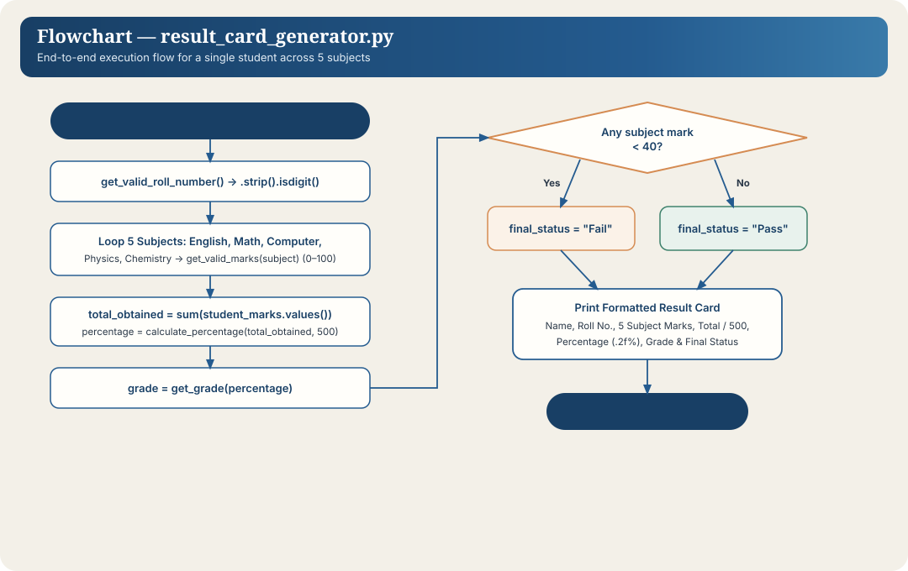
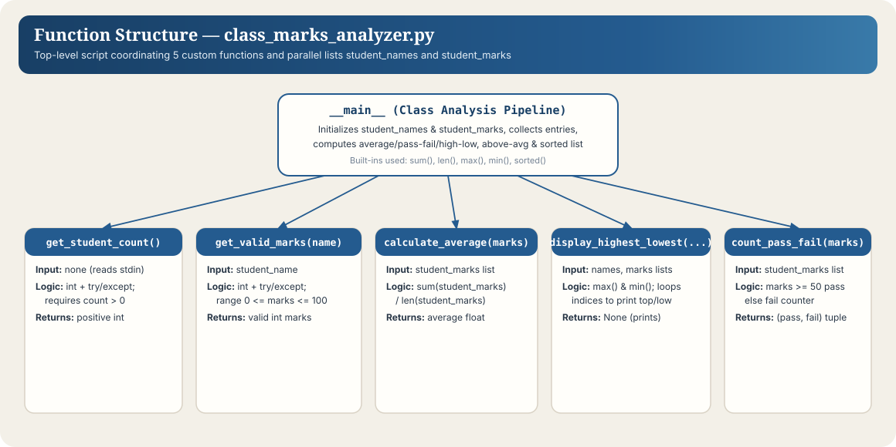
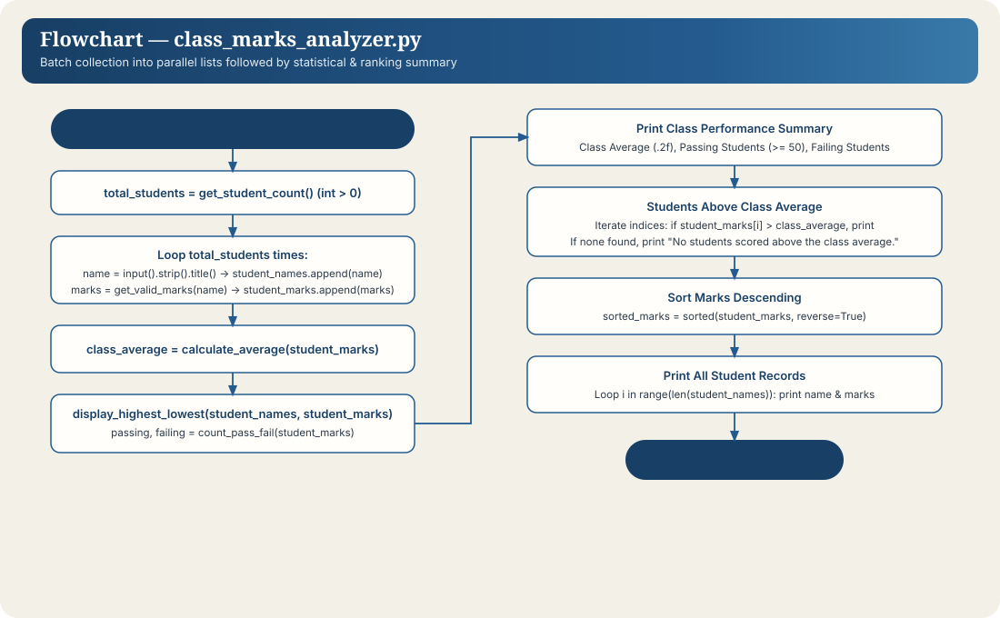
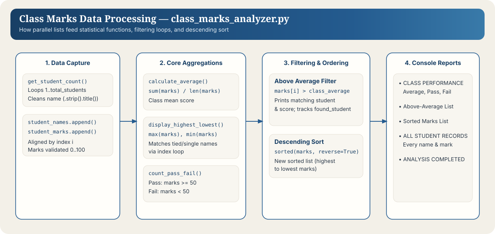
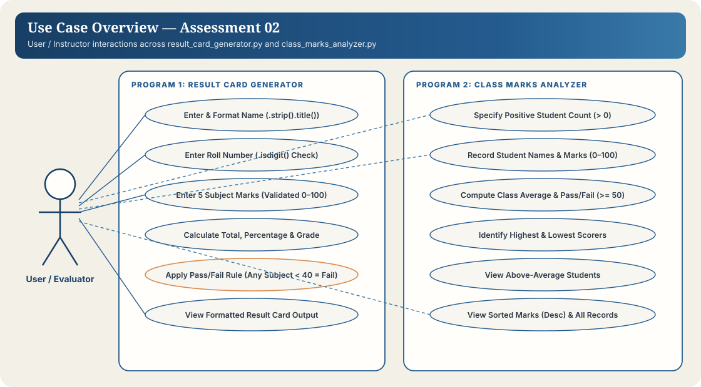
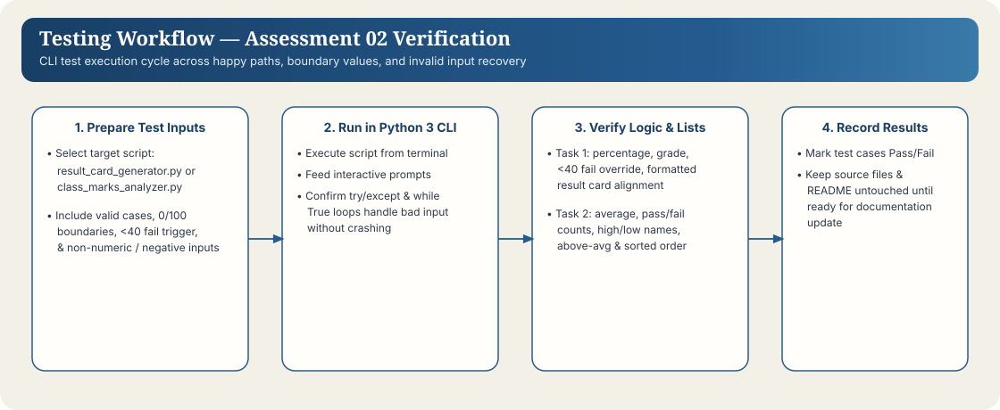

 <div align="center">


### Python Bootcamp — Assessment 02

**Two practical Python applications demonstrating Functions, Strings, Lists, Input Validation, and Data Analysis.**

<br>


<br><br>

<a href="https://aliabbas0014.github.io/python-functions-lists-assessment/demo.html">
  
</a>
<a href="https://github.com/aliabbas0014/python-functions-lists-assessment">
  
</a>
<a href="#project-documentation">
  
</a>

</div>

---

## 📌 Project Overview

This repository contains two Python console-based applications developed as part of **Assessment 02** of the Python Bootcamp.

The main purpose of this assessment is to practice Python functions, string manipulation, lists, loops, conditional statements, and input validation through practical programming tasks.

### Applications Included

| Application | Description |
|---|---|
| Student Result Card Generator | Generates a student's result card by calculating total marks, percentage, and grade. |
| Class Marks Analyzer | Analyzes marks of multiple students and displays useful class performance statistics. |

## 🛠️ Technologies & Concepts

- **Language:** Python
- **Documentation & Demo:** HTML5
- **Hosting:** GitHub Pages
- **Functions:** Creating and calling reusable functions
- **Strings:** String formatting and name manipulation
- **Lists:** Storing and processing student marks
- **Loops:** Repeating operations and processing records
- **Conditional Statements:** Applying grading and pass/fail conditions
- **Input Validation:** Handling invalid user input
- **Basic Data Analysis:** Calculating averages, highest marks, and lowest marks

---

# Project Documentation

## 1. Student Result Card Generator

### 📖 Description

The Student Result Card Generator is a Python program that takes a student's information and subject marks as input. It calculates the total marks, percentage, and grade, then displays the result in a properly formatted result card.

The program also applies input validation to ensure that the entered information and marks are within the expected range.

### ⚙️ Main Features

- Takes student name and roll number as input.
- Accepts marks for multiple subjects.
- Validates marks before processing.
- Calculates total obtained marks.
- Calculates overall percentage.
- Assigns a grade according to the percentage.
- Displays the final result card.

### 🧮 Grading Criteria

| Percentage | Grade |
|---|---|
| 90% and above | A+ |
| 80% – 89% | A |
| 70% – 79% | B |
| 60% – 69% | C |
| 50% – 59% | D |
| Below 50% | Fail |

**Passing Condition:** A student must obtain at least 40 marks in each subject to pass the result card assessment.

### 🧩 Function Structure

The program uses separate functions to perform different tasks, making the code easier to understand and maintain.

**Important functions:**
- `format_name()`
- `get_valid_marks()`
- `calculate_percentage()`
- `get_grade()`
- `get_valid_roll_number()`

### 📊 Function Structure Diagram


### 🔄 Result Card Flowchart



### 📋 Result Generation Process


### 🎯 Grading Decision Flowchart


---

## 2. Class Marks Analyzer

### 📖 Description

The Class Marks Analyzer is a Python program designed to process and analyze the marks of multiple students. It stores student marks in lists and performs calculations to provide an overview of class performance.

It helps identify the highest and lowest marks, calculate the class average, and count the number of students who passed or failed.

### ⚙️ Main Features

- Takes marks of multiple students as input.
- Stores marks in a Python list.
- Validates entered marks.
- Calculates the class average.
- Finds the highest and lowest marks.
- Counts passed and failed students.
- Displays a summary of class performance.

### 🧮 Pass/Fail Criteria

| Marks | Status |
|---|---|
| 50 or above | Pass |
| Below 50 | Fail |

### 🧩 Function Structure

The program uses functions to organize the input, processing, and analysis tasks. Lists are used to store and process student marks.

### 📊 Function Structure Diagram



### 🔄 Class Analyzer Flowchart



### 📈 Class Data Processing



### 📝 List Processing Workflow


---

## 3. Common Project Documentation

This section contains diagrams that explain the overall structure, user interaction, validation, and testing approach used in the project.

### 🏗️ Project Architecture


### 👥 Use Case Diagram



### ✅ Input Validation Workflow


### 🧪 Test Cases


### 🔍 Testing Workflow



---

## 📁 Project Structure

```text
python-functions-lists-assessment/
│
├── assets/
│   ├── assessment-02/
│   │   ├── project-architecture.svg
│   │   ├── result-card-function-structure.svg
│   │   ├── class-analyzer-function-structure.svg
│   │   ├── use-case-diagram.svg
│   │   ├── result-card-flowchart.svg
│   │   ├── class-analyzer-flowchart.svg
│   │   ├── result-generation-process.svg
│   │   ├── class-data-processing.svg
│   │   ├── grading-decision-flowchart.svg
│   │   ├── input-validation-workflow.svg
│   │   ├── list-processing-workflow.svg
│   │   ├── test-cases.svg
│   │   └── testing-workflow.svg
│   │
│   └── svg-buttons/
│       ├── live-demo.svg
│       ├── source-code.svg
│       └── explore-project.svg
│
├── result_card_generator.py
├── class_marks_analyzer.py
├── demo.html
└── README.md
```

## ▶️ How to Run the Programs

### Requirements

- Python 3.x
- Any code editor (VS Code recommended)

### Step 1: Clone the Repository

```bash
git clone https://github.com/aliabbas0014/python-functions-lists-assessment.git
```

### Step 2: Open the Project Folder

```bash
cd python-functions-lists-assessment
```

### Step 3: Run Student Result Card Generator

```bash
python result_card_generator.py
```

### Step 4: Run Class Marks Analyzer

```bash
python class_marks_analyzer.py
```

## 🎓 Learning Outcomes

Through this assessment, I practiced and improved my understanding of:

- Creating reusable functions in Python.
- Working with strings and formatting text.
- Using lists to store and manage data.
- Applying loops and conditional statements.
- Validating user input.
- Performing calculations using functions.
- Analyzing student marks and displaying results.
- Organizing programs into smaller and manageable parts.

## 🌐 Live Demo

You can explore the project documentation and interactive demo through the link below.

<div align="center">

<a href="https://aliabbas0014.github.io/python-functions-lists-assessment/demo.html">
  
</a>

</div>

---

## 👨‍💻 Developer

<div align="center">


### Ali Abbas

**Software Engineering Graduate | Python Bootcamp Student | Web Developer**

Building practical projects while learning and exploring modern technologies.

<br>


<br><br>

<a href="https://github.com/aliabbas0014">
  
</a>
<a href="https://www.linkedin.com/in/the-aliabbas/">
  
</a>
<a href="https://aliabbas0014.github.io/Portfolio/">
  
</a>

<br><br>

</div>

---

<div align="center">


**Python Bootcamp — Assessment 02**

*Learning by building. Improving through practice.*

</div>
